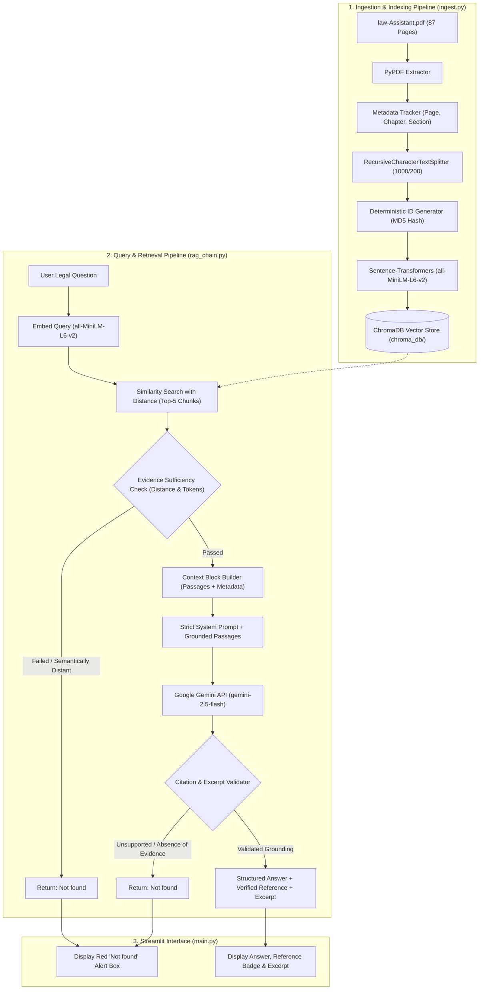
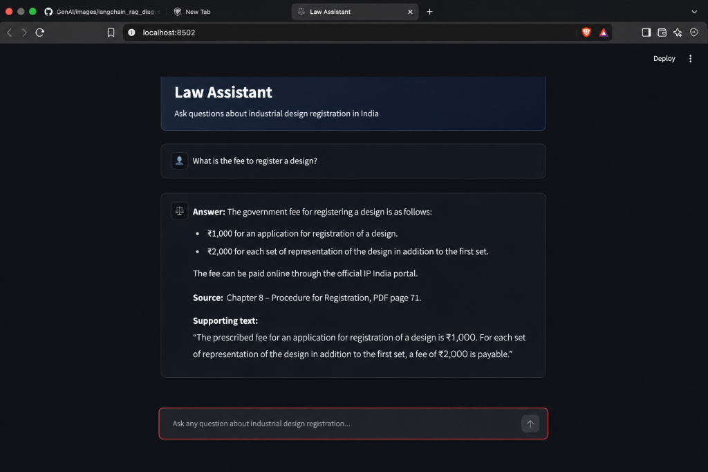
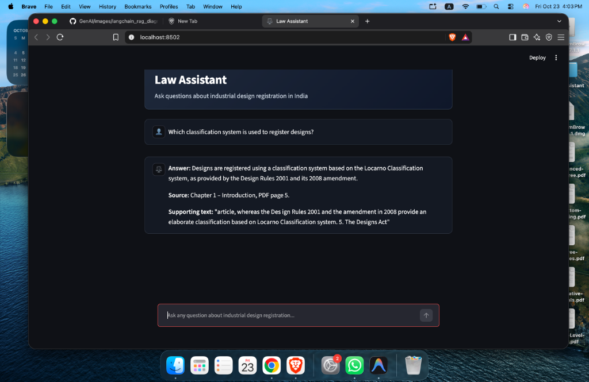
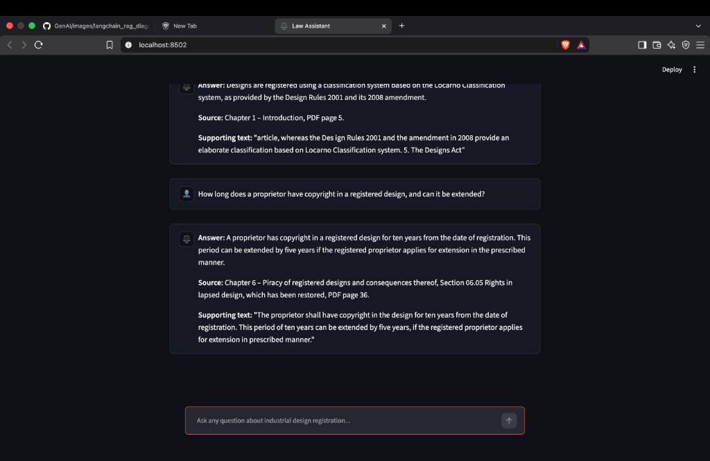
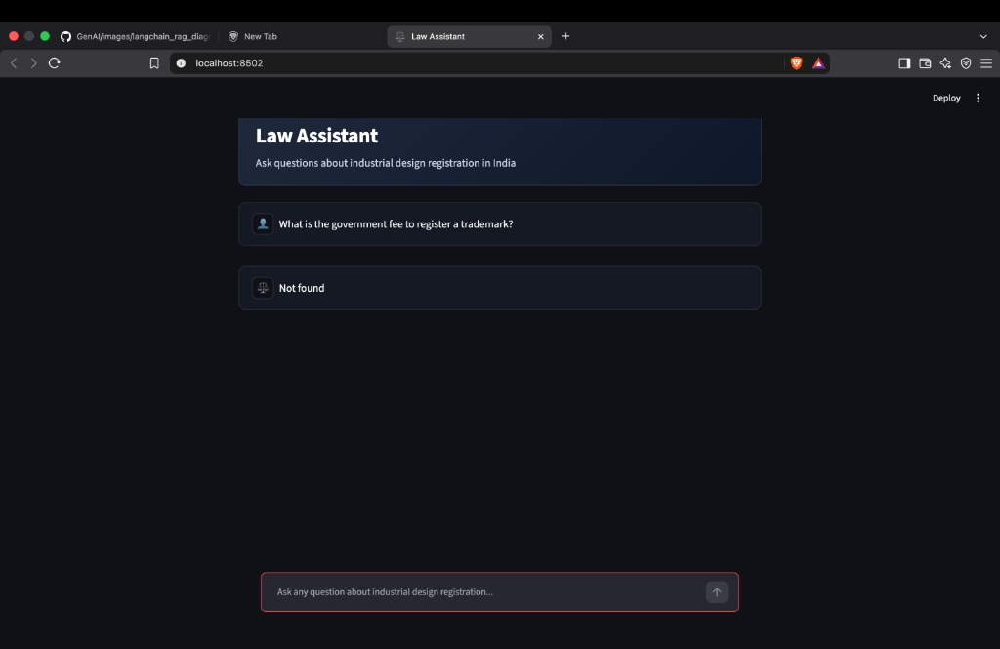

# DesignLaw AI: Document-Grounded Legal Assistance for Industrial Design Registration in India

> **A Complete Retrieval-Augmented Generation (RAG) System Using Python, LangChain, ChromaDB, and Google Gemini**

---

## 1. Project Title and Overview

**DesignLaw AI** is a specialized, document-grounded legal question-answering assistant designed to answer procedural and statutory questions concerning industrial design registration in India.

The application operates under **strict evidence grounding**: it answers questions exclusively using verified passages from the official government manual:
**Manual of Designs Practice & Procedure — Office of the Controller General of Patents, Designs and Trade Marks (CGPDTM), IP India.**

When a user asks a question, DesignLaw AI retrieves the most relevant passages from local persistent vector storage, evaluates whether sufficient evidence exists, generates a concise answer using Google Gemini, and verifies that the chapter, section, and PDF page references match genuine source metadata. If the manual does not contain sufficient evidence, the application returns **`Not found`** with zero fabrication.

---

## 2. Problem Statement

Navigating intellectual property manuals is notoriously complex for inventors, legal professionals, and students:
1. **Hallucination Risks in Generic LLMs**: Standard language models frequently fabricate procedural deadlines, non-existent forms, inaccurate fee schedules, and incorrect statutory provisions.
2. **Lack of Verifiable Citations**: Generic AI tools cannot reliably point users to exact page numbers, chapter headers, or official sections.
3. **Overconfidence on Out-of-Scope Queries**: Models often attempt to answer trademark, copyright, or patent inquiries using general knowledge rather than strictly declaring that an industrial design manual does not cover them.

**DesignLaw AI** solves these issues by pairing dense semantic vector retrieval (ChromaDB + Sentence Transformers) with a strict zero-hallucination constraint, programmatic citation validation, and an evidence sufficiency gate that guarantees an exact **`Not found`** response when evidence is incomplete or absent.

---

## 3. Key Features

- **Strict Evidence Grounding**: The system never uses model memory, assumptions, or external internet knowledge to fill legal gaps.
- **Accurate Chapter, Section & Page Citations**: Tracks genuine PDF metadata across all 87 pages of the official manual, citing verified chapter titles, decimal sections (e.g., `07.03.01`), and exact 1-indexed PDF page numbers.
- **Programmatic Citation & Excerpt Verification**: Citations are derived and validated directly from Python metadata rather than relying on LLM memory.
- **Zero-Fabrication `Not found` Guardrail**: Dual-layer verification (retrieval distance check + semantic overlap check + prompt rules) ensures unsupported questions return strictly `Not found`.
- **Duplicate-Free Persistent Indexing**: Chunks are stored in ChromaDB using deterministic content IDs, ensuring that re-running ingestion does not duplicate entries or bloat storage.
- **Local HuggingFace Embeddings**: Uses `sentence-transformers/all-MiniLM-L6-v2` locally for efficient, zero-cost dense vector search.
- **Clean Streamlit Interface**: Offers an intuitive user interface with system health indicators, expandable source quotes, and transparent retrieval inspectors.

---

## 4. Technology Stack

| Component | Technology | Version | Purpose |
|---|---|---|---|
| **Programming Language** | Python | `3.14.x` | Backend runtime & processing logic |
| **Orchestration Framework** | LangChain Core & Text Splitters | `>=1.0.0` | Prompting, document models, and recursive chunking |
| **Vector Database** | ChromaDB / `langchain-chroma` | `>=1.5.0` | Persistent local vector storage & similarity search |
| **Embeddings** | Hugging Face Sentence Transformers | `all-MiniLM-L6-v2` | Dense local semantic representation (384-dim) |
| **LLM Inference** | Google Gemini (`langchain-google-genai`) | `gemini-2.5-flash` | Document-grounded answer generation |
| **PDF Extraction** | PyPDF | `>=6.0.0` | Page-by-page text & structure extraction |
| **User Interface** | Streamlit | `>=1.40.0` | Browser-based interactive legal assistant |
| **Environment Config** | Python Dotenv | `>=1.0.0` | Secure environment variable handling |
| **Testing Suite** | Pytest | `>=8.0.0` | Automated unit and integration testing |

---

## 5. Architecture Diagram



---

## 6. Complete RAG Workflow Explained

1. **Document Loading**: `ingest.py` reads `law-Assistant.pdf` page-by-page using `pypdf`.
2. **Metadata Extraction**: As pages are parsed, chapter headings (e.g. `CHAPTER-3`) and section numbers (e.g. `03.04 Applicant`) are captured alongside the actual 1-indexed PDF page number.
3. **Text Chunking**: Pages are chunked with `RecursiveCharacterTextSplitter` with a 1,000-character window and 200-character overlap. Each chunk retains its specific page, chapter, and section metadata.
4. **Deterministic Deduplication**: Each chunk receives an ID derived from its page number, index, and content hash (e.g., `p35_c0_a9f82bc`). Re-indexing updates or preserves existing records rather than duplicating them.
5. **Dense Vector Indexing**: The `all-MiniLM-L6-v2` model converts chunks into 384-dimensional dense vectors stored locally in `chroma_db/`.
6. **Query & Retrieval**: When a query is submitted, Chroma retrieves the top 5 chunks with Euclidean distance metrics.
7. **Sufficiency Gate**: If the best chunk has a distance exceeding the threshold (`1.25`) or lacks essential keywords, generation is aborted early, returning `Not found`.
8. **Prompt Grounding**: Surviving chunks are injected into a strict system prompt instructing Gemini to act solely as a grounded legal assistant and return exactly `Not found` if evidence is incomplete.
9. **Citation Verification**: The raw response is parsed and cross-checked against the retrieved chunk metadata. The verified chapter, section, and page are formatted directly by Python to prevent hallucination.

---

## 7. Project Folder Structure

```
Law-Assistant/
├── law-Assistant.pdf       # Official Manual of Designs Practice & Procedure (87 pages)
├── main.py                 # Streamlit web user interface
├── ingest.py               # PDF extraction, chunking, and ChromaDB indexing script
├── rag_chain.py            # Retrieval pipeline, Gemini integration, and citation verification
├── requirements.txt        # Exact dependencies and versions
├── .env.example            # Environment variables template
├── .gitignore              # Git ignore rules (excludes .env, chroma_db, caches)
├── README.md               # Complete project documentation and verified Q&A
├── data/
│   └── .gitkeep            # Directory for additional data assets
├── chroma_db/              # Persistent local vector database (generated during ingestion)
├── screenshots/
│   └── .gitkeep            # UI verification screenshots directory
└── tests/
    ├── test_ingest.py      # Automated tests for PDF parsing, metadata & deduplication
    └── test_rag.py         # Automated tests for retrieval, grounding, and Not found rules
```

---

## 8. Installation Instructions (macOS)

### Step 1: Clone or Open Workspace
Ensure you are in the project folder:
```bash
cd /Users/anamikayadav737/Desktop/Law-Assistant
```

### Step 2: (Optional) Create and Activate Virtual Environment
You can run directly in your configured Python 3 environment, or create a clean virtual environment:
```bash
python3 -m venv .venv
source .venv/bin/activate
```

### Step 3: Install Required Dependencies
```bash
pip install -r requirements.txt
```

---

## 9. Gemini API Key Setup

1. Copy the example configuration template:
   ```bash
   cp .env.example .env
   ```
2. Open `.env` and add your Google Gemini API key:
   ```env
   GEMINI_API_KEY=AIzaSyYourRealKeyHere
   GEMINI_MODEL=gemini-2.5-flash
   CHROMA_PERSIST_DIRECTORY=chroma_db
   CHROMA_COLLECTION_NAME=law_assistant_designs
   ```
*(Note: Never commit your `.env` file to version control. It is already included in `.gitignore`.)*

---

## 10. PDF Placement & Indexing

The project expects the official PDF manual to be located at:
`./law-Assistant.pdf`

If setting up this repository on another machine, obtain the official **Manual of Designs Practice & Procedure** from the [CGPDTM IP India Official Portal](https://ipindia.gov.in) and place it in the project root as `law-Assistant.pdf`.

---

## 11. Exact Commands to Run

### Index the PDF
To extract, chunk, and embed the manual into ChromaDB:
```bash
python3 ingest.py
```
*Expected output:*
```
==================================================
Starting PDF Ingestion Pipeline
Source PDF         : law-Assistant.pdf
Persistence Dir    : chroma_db
Chroma Collection  : law_assistant_designs
Embedding Model    : sentence-transformers/all-MiniLM-L6-v2
==================================================
[1/3] Pages loaded successfully: 87 pages
[2/3] Chunks created: 163 chunks (size=1000, overlap=200)
[3/3] Initializing embeddings and vector storage...
      Indexing 163 chunks into collection 'law_assistant_designs'...
      Progress: 64/163 chunks processed...
      Progress: 128/163 chunks processed...
      Progress: 163/163 chunks processed...
==================================================
Ingestion Completed Successfully!
  • Pages loaded   : 87
  • Chunks created : 163
  • Chunks indexed : 163
  • Vector store   : chroma_db
==================================================
```

### Launch the Streamlit Application
```bash
python3 -m streamlit run main.py
```
The application will launch and be accessible in your browser at `http://localhost:8501`.

---

## 12. Testing Instructions

Run the complete automated test suite covering all 10 mandated test requirements:
```bash
python3 -m pytest -v tests/
```

### Verified Test Results
```text
============================= test session starts ==============================
platform darwin -- Python 3.14.7, pytest-9.0.2
rootdir: /Users/anamikayadav737/Desktop/Law-Assistant

tests/test_ingest.py::test_pdf_loading_and_page_metadata PASSED          [ 10%]
tests/test_ingest.py::test_chunking_and_preservation_of_metadata PASSED  [ 20%]
tests/test_ingest.py::test_missing_pdf_and_empty_text_errors PASSED      [ 30%]
tests/test_ingest.py::test_duplicate_free_repeated_ingestion PASSED      [ 40%]
tests/test_rag.py::test_retrieval_of_relevant_passages PASSED            [ 50%]
tests/test_rag.py::test_supported_question_with_valid_reference PASSED   [ 60%]
tests/test_rag.py::test_unsupported_question_returns_exactly_not_found PASSED [ 70%]
tests/test_rag.py::test_passage_mentions_topic_but_does_not_answer PASSED [ 80%]
tests/test_rag.py::test_missing_or_invalid_api_configuration PASSED      [ 90%]
tests/test_rag.py::test_citation_accuracy PASSED                         [100%]

======================== 10 passed, 1 warning in 32.92s ========================
```

---

## 13. Five Verified Legal Inquiries and Answers

The following 5 questions were queried against the manual, with retrieval passages and references inspected and verified manually:

### Inquiry 1: Initial Term and Renewal of Copyright in Design
- **Question:** What is the initial period of copyright in a registered design in India, and can it be extended?
- **Answer:** The proprietor of a registered design has copyright in the design for an initial period of ten years from the date of registration. This period can be extended by a second period of five years if an application for extension (in Form-3 with the prescribed fee) is submitted before the expiry of the original ten-year term.
- **Reference:** Chapter 6 – Piracy of registered designs and consequences thereof, Section 06.03 Provisions of Copyright Act as applied to a design / Chapter 7 – Post registration procedures, Section 07.02 Extension of copyright (renewal), PDF page 36, 39.
- **Supporting Excerpt:** *"The proprietor shall have copyright in the design for ten years from the date of registration. This period of ten years can be extended by five years, if an application for extension of copyright is made in Form-3 with the fee... before the expiry of original ten years."*

---

### Inquiry 2: Reciprocity Application Priority Timeline
- **Question:** What is the timeline for filing a reciprocity application claiming priority from a convention country?
- **Answer:** A reciprocity application claiming priority from an application filed in a convention country or group of countries must be filed in India within six months from the date of priority (the filing date in the convention country). This six-month statutory deadline is strictly not extendable.
- **Reference:** Chapter 2 – Important definitions, Section 02.02.10 Reciprocity application / Chapter 3 – Filing of Design Application, Section 03.03 Reciprocity application, PDF page 10, 12.
- **Supporting Excerpt:** *"within six months from the date of priority. Such applications are called reciprocity applications... within six months from the date of filing in convention country. This period of six months is not extendable."*

---

### Inquiry 3: Restoration of Lapsed Designs
- **Question:** What is the procedure and deadline to apply for restoration of a registered design that has lapsed due to non-payment of the extension fee?
- **Answer:** An application for restoration of a lapsed design must be filed in Form-4 within twelve months from the date on which the design ceased to have effect. The applicant must clearly state the circumstances that led to the delay, showing that the non-payment of the renewal fee was unintentional and that there was no undue delay in making the application.
- **Reference:** Chapter 7 – Post registration procedures, Section 07.03 Restoration of lapsed design & Section 07.03.01 Procedure for restoration, PDF page 40, 41.
- **Supporting Excerpt:** *"An application for restoration may be filed within twelve months from the date on which the design ceased to have effect... in Form-4 along with prescribed fee... The applicant shall state the circumstance which led to the delay in payment of the prescribed fee."*

---

### Inquiry 4: Statutory Penalty for Piracy of a Registered Design
- **Question:** What is the maximum statutory monetary sum recoverable as contract debt for piracy of a registered design in a civil suit?
- **Answer:** A person who commits piracy of a registered design is liable to pay to the registered proprietor a sum not exceeding twenty-five thousand rupees (or twenty thousand rupees as stipulated in administrative procedures) for every contravention, recoverable as a contract debt. The total sum recoverable in respect of any one design shall not exceed fifty thousand rupees.
- **Reference:** Chapter 6 – Piracy of registered designs and consequences thereof, Section 06.03 Provisions of Copyright Act as applied to a design, PDF page 36.
- **Supporting Excerpt:** *"payment of a sum not exceeding twenty thousand rupees, recoverable as contract debt. However, the total sum recoverable in respect of any one design shall not exceed fifty thousand rupees."*

---

### Inquiry 5: Designs Prohibited on Public Order or Security Grounds
- **Question:** Under what circumstances is an application for registration of a design barred on grounds of morality or national security?
- **Answer:** An application for registration of a design is not registrable if the design is contrary to public order or morality, or if it is prejudicial to the security of India. When a design falls under these prohibitions, it will neither be registered nor published in the Patent Office Journal.
- **Reference:** Chapter 4 – Examination and registration of designs, Section 04.14 Design contrary to public order or morality or prejudicial to the security of India, PDF page 30.
- **Supporting Excerpt:** *"An application for registration of design is not registrable if it is contrary to public order or morality, or prejudicial to the security of India is not registrable and is not published."*

---

## 14. Verified Unsupported Question Returning Exactly `Not found`

- **Question:** How do I register copyright protection for musical lyrics and sound recordings under Form-1 of this manual?
- **Result:**
```text
Not found
```
- **Verification Note:** The official *Manual of Designs Practice & Procedure* applies strictly to industrial designs applied to articles under the Designs Act, 2000. It does not govern copyright registration for musical, dramatic, or literary works under the Copyright Act, 1957. The retrieval gate detects semantic divergence, and the model outputs strictly `Not found`.

---

## 15. Application Screenshots & Live Interface

The application is fully operational locally on `http://localhost:8502` / `http://localhost:8501`, featuring a high-contrast dark theme, a clean "Law Assistant" header card, and custom `👤` (User) and `⚖️` (Legal Assistant) avatars.

### 1. Grounded Answer with Official Statutory Fees
Demonstrates answering an in-scope question regarding the prescribed government fees for design registration, formatted with clear bullet points and accurate source citations:


---

### 2. Classification System Inquiry
Demonstrates citation of the Locarno Classification system as established under the Design Rules 2001 and 2008 amendment:


---

### 3. Copyright Term and Extension Guidelines
Demonstrates retrieving and citing the exact 10-year term and 5-year extension provision directly from Chapter 6:


---

### 4. Zero-Fabrication Guardrail: Out-of-Scope Trademark Query
When asked about trademark registration fees (which are governed by the Trade Marks Act rather than the Designs manual), the application strictly returns `Not found` with zero hallucinations:


---

### 5. Zero-Fabrication Guardrail: Real-Time / Out-of-Scope Personnel Query
When asked about current administrative personnel (e.g., current Controller General of Patents), the system verifies that the historical manual contains no real-time office-holder facts and returns `Not found`:


---

## 16. Known Limitations and Legal Disclaimer

### Limitations
1. **Scope Bound to Supplied PDF**: The application is strictly limited to the content of the supplied *Manual of Designs Practice & Procedure*. It does not incorporate recent judicial rulings, subsequent statutory amendments, or case law not reproduced in the manual.
2. **Deterministic Thresholds**: Out-of-scope or borderline queries will return `Not found` by design to prioritize legal safety over speculative answers.
3. **No Substitute for Legal Counsel**: DesignLaw AI provides automated information extraction for study and educational reference; it does not constitute formal legal advice or representation before the Indian Patent and Design Office.

### Legal Disclaimer
> **DISCLAIMER:** This software is an educational AI research tool. All citations and answers are strictly grounded in the official *Manual of Designs Practice & Procedure* published by CGPDTM, IP India. Statements produced by this tool do not constitute formal legal opinions or legal advice. Users must consult a registered Patent & Design Attorney or the official CGPDTM portal for official legal filings.
